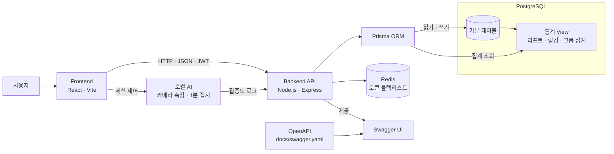

# FocusLens

FocusLens는 사용자의 집중 세션과 집중도 데이터를 기록·분석하고, 리포트·소셜·그룹 관리 기능을 제공하는 프로젝트다. 프런트엔드, AI, 백엔드를 하나의 저장소에서 관리하는 모노레포 구조를 사용한다.

## 로컬에서 실행

Node.js 22.x(22.13 이상)를 설치하고 Docker Desktop을 켠다. Mac에서 웹캠으로 집중도를 측정하려면 Python 3.11도 준비한다. VS Code로 `focusLens` 폴더를 열고 **터미널 → 새 터미널**에서 실행한다.

```sh
npm start
```

터미널에 준비 완료 안내가 나오면 [FocusLens 로그인 화면](http://localhost:5173/login)을 연다. 첫 실행은 필요한 의존성을 설치하므로 시간이 걸릴 수 있다. Mac에서는 로컬 AI도 함께 실행된다. Windows에서는 웹과 백엔드가 실행되며 터미널에 카메라 측정 제한이 표시된다. 같은 터미널에서 `Ctrl+C`를 누르면 이번에 시작한 서비스를 종료한다. 계정과 학습 기록은 다음 실행에도 유지된다. [테스트 계정과 카메라 사용법](docs/frontend-handoff.md)

## 구현 현황

| 영역 | 상태 | 설명 |
| --- | --- | --- |
| Backend | Phase 1~4 완료 + 연동 확장 | 38개 API, 로그 v2, Refresh Token, Roll-up, 보안·성능 검증 완료 |
| Frontend | 로컬 백엔드·AI 연동 | 로그인, 학습 세션, 대시보드, 리포트, 소셜·그룹 화면 |
| AI | 실제 카메라 연동 | 웹캠 특징 추출, 1분 단위 점수 집계, 로컬 API 전송 |

## 전체 프로젝트 아키텍처

### 런타임 구성



백엔드는 Phase 1~4를 완료했다. 클라이언트는 JWT 기반 HTTP API를 통해 데이터에 접근한다. 카메라 측정 로그는 백엔드에 저장되고, 프런트엔드는 세션 리포트와 주간·월간 집중도를 조회한다. 평균 집중도, 학습 시간, 반응 수, 랭킹과 같은 파생 값은 PostgreSQL View에서 계산한다.

### 저장소 구조

```text
focusLens/
├── frontend/                        # React·Vite 프런트엔드
├── ai/                              # 웹캠 특징 추출과 점수 계산
├── backend/                         # Express API 애플리케이션
│   ├── app.js                       # 미들웨어, 라우터, Health Check, Swagger UI
│   ├── server.js                    # HTTP 서버 진입점
│   ├── Dockerfile
│   ├── package.json                 # 백엔드 런타임·Prisma 의존성
│   └── src/
│       ├── routes/                  # API 경로·입력 검증·JWT 적용
│       ├── controllers/             # 도메인별 요청 처리와 비즈니스 로직
│       ├── middleware/              # 인증, 검증 결과, 전역 오류 처리
│       ├── models/prismaClient.js   # Prisma Client 싱글턴
│       ├── services/redis.js        # 토큰 블랙리스트와 Redis 연결
│       └── utils/focusScore.js      # 집중도 계산·평균·상태 판정
├── prisma/
│   ├── schema.prisma                # 도메인 16개와 Roll-up 3개 모델
│   ├── migrations/                  # DB 스키마·제약·View 마이그레이션
│   ├── views.sql                    # 통계 View 재적용 스크립트
│   └── seed.js                      # 개발용 시드 데이터
├── src/                             # Jest 테스트
│   ├── controllers/                 # 컨트롤러 단위 테스트
│   └── utils/                       # 실제 백엔드 유틸 단위 테스트
├── docs/                            # 기획, ERD, API, 보안, 운영 문서
│   └── swagger.yaml                 # Swagger UI가 사용하는 OpenAPI 단일 원본
├── .agents/                         # 개발 에이전트용 규칙과 워크플로
├── AGENTS.md                        # 프로젝트 공통 개발 규칙
├── docker-compose.yml               # API·PostgreSQL·Redis 실행 구성
├── package.json                     # 테스트와 DB 작업용 루트 명령
└── README.md
```

백엔드 요청은 `route → middleware → controller → Prisma/Redis` 순서로 처리된다. `prisma/`는 백엔드와 분리된 공용 데이터 계층이며 스키마, 마이그레이션, 통계 View, 개발용 시드를 관리한다. 루트 `src/`는 애플리케이션 소스가 아니라 백엔드 Jest 테스트 모음이다.

## API 문서

- Swagger UI: `http://localhost:3000/api-docs/`
- OpenAPI JSON: `http://localhost:3000/api-docs/openapi.json`
- Health check: `http://localhost:3000/health`

Swagger UI의 `Authorize` 버튼에 로그인 응답의 `access_token`을 입력하면 보호된 API를 브라우저에서 직접 호출할 수 있다.
